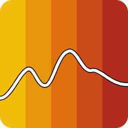

<p align="center">
  
</p>

# engiNIR

[](https://doi.org/10.5281/zenodo.23235907)
[](https://enginir.readthedocs.io/en/stable/)
[](https://pypi.org/project/enginir/)
[](https://pypi.org/project/enginir/)

engiNIR turns near-infrared spectra and hyperspectral images into validated
calibration models and property predictions, with every step recorded. It is
built for pharmaceutical process analytics: tablets on a tray, scanned by a
push-broom camera, measured against target values.

## Workflow

1. **Import** EVK EIFF, ENVI, HDF5, CSV/Excel, SPC, SPA and JCAMP-DX data.
   Several scans form one project; references can come from separate files,
   frames of the same scan or another scan.
2. **Correct** raw counts to reflectance or absorbance with dark and white
   references or detector levels.
3. **Draw regions** (ROIs) on the samples, one by one or as a grid over a
   tray, and assign target values.
4. **Preprocess** with recipes: Savitzky-Golay smoothing and derivatives, SNV,
   MSC, EMSC, detrending, AsLS baseline correction and band selection.
5. **Model** with PLS or PCR, cross-validated by ROI so that no sample's
   pixels are split across folds. The number of components can be chosen
   automatically (one-SE, Q² and F-test rules with a noise guard).
6. **Review** figures of merit, scores and loadings, VIP and selectivity
   ratio, Hotelling's T² and the distance to the model (DModX).
7. **Predict** new scans: a prediction map with the distance to the model and
   a 95 % prediction interval per pixel, and per-tablet results for marked
   prediction ROIs.

## Guarantees

- Calibration and prediction run through the same reference correction and preprocessing
  pipeline; fitted MSC/EMSC states are stored with the model.
- Pixels are the data points of the fit, ROIs the reporting unit: cross-validation, reported
  metrics and stateful preprocessing respect the ROI.
- Prediction is refused when a scan does not match the model's instrument
  format, number of bands, reference correction or signal unit.
- Every pixel prediction says whether it is inside the model (DModXPS and
  T²PS against their 0.99 limits) and how precise it is (leverage-based
  interval); outside the model it gets no interval.
- One project file links data, references, ROIs, recipes and models by stable
  ids; stored objects are never silently overwritten. Predictions are kept in
  memory and logged with their provenance.

## Usage

engiNIR needs Python 3.12 or newer. Add it to a
[uv](https://docs.astral.sh/uv/) project:

```bash
uv add enginir
```

To work on engiNIR itself, clone the repository and run `uv sync --all-extras`.

**The viewer on Windows, without Python knowledge:** paste this line into
PowerShell, then start *engiNIR Viewer* from the Start menu (details in the
[installation guide](https://enginir.readthedocs.io/en/stable/user_guide/installation.html)):

```powershell
powershell -ExecutionPolicy ByPass -c "irm https://github.com/TUstudents/engiNIR/releases/latest/download/install-enginir-for-windows.ps1 | iex"
```

### Viewer

The desktop viewer runs the whole workflow interactively:

- **Explore**: images and spectra of the project's scans, ROIs and ROI grids.
- **Model**: target values, fitting and refitting, and the diagnostics
  pages Fit, Spectral (coefficients, loadings, VIP), Components and Distance
  (DModX and T²).
- **Predict**: prediction ROIs and maps with diagnostic and uncertainty
  layers, per-ROI results in the ROI table.

Every plot exports PNG, SVG and CSV.

```bash
uv run enginir-viewer                                  # welcome screen
uv run enginir-viewer scan.eiff --dark dark.eiff --white white.eiff
uv run enginir-viewer project.h5
```

### Library

The library can be used in two ways.

**Project mode** records every step in a project file, so each result is
reproducible and traceable to its data. Recommended unless you know exactly
which steps you need:

```python
from enginir import PreprocessingRecipe, Project

project = Project.create("tablets.h5")
scan = project.add_dataset("scan.eiff", dark="dark.eiff", white="white.eiff")
project.add_target("API content", unit="% w/w")
scan.add_roi("tablet 1", frames=(0, 4), rows=(0, 9), values={"API content": 1.0})
# ... more ROIs, and ROIs marked job="prediction" for the tablets to predict
model = project.fit("API content", recipe=PreprocessingRecipe(snv=True),
                    n_components="auto")
model.metrics["rmsecv"]

prediction = model.predict("new_scan.eiff")
prediction.map                  # one value per pixel
prediction.dmodx_map            # distance to the model
prediction.interval_map()       # ± half-width of the 95 % prediction interval

result = model.predict_rois()   # per tablet: mean, SD, interval, RMSEP
```

**Function mode** uses the readers, preprocessing steps, models and
validation functions directly on arrays, as scikit-learn estimators:

```python
from sklearn.pipeline import make_pipeline
from enginir.models import PLSRegression
from enginir.preprocessing import SNV
from enginir.validation import cross_validate

model = make_pipeline(SNV(), PLSRegression(n_components=4))
cv = cross_validate(model, X, y, cv="logo", groups=samples)   # cv["rmsecv"], cv["y_pred"]
```

### Documentation

The documentation is at <https://enginir.readthedocs.io>: a workflow guide,
the user guide for each step and the viewer, the API reference, and the file
formats. To build it locally:

```bash
uv sync --extra docs
uv run python -m sphinx -b html docs docs/_build/html
```

## Citation

If you use engiNIR in your work, please cite:

> Johannes Poms. (2026). TUstudents/engiNIR: A universal engineering tool for
> near-infrared spectra and hyperspectral imaging. Zenodo.
> https://doi.org/10.5281/zenodo.23235907

## License

engiNIR © 2026 Johannes Poms and contributors, licensed under
[CC BY 4.0](LICENSE).
