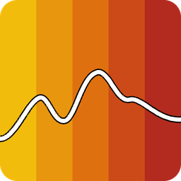
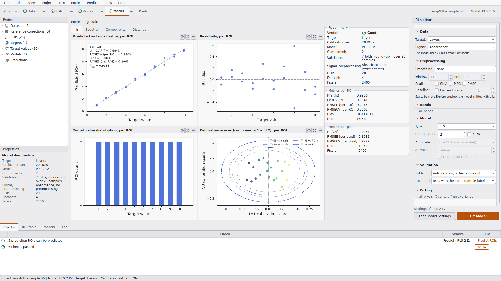
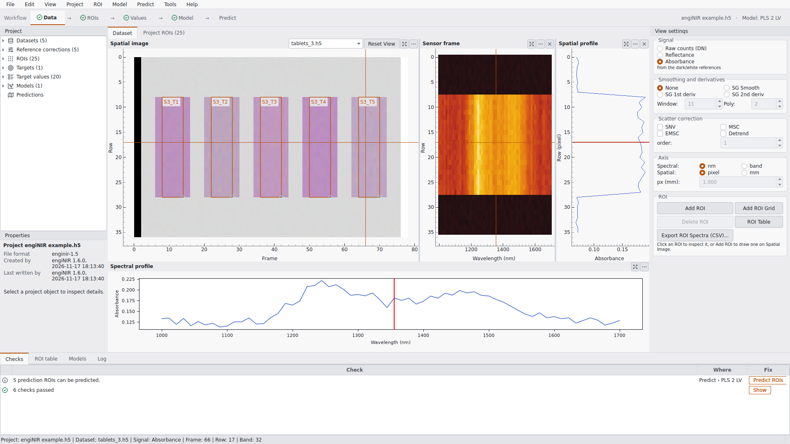
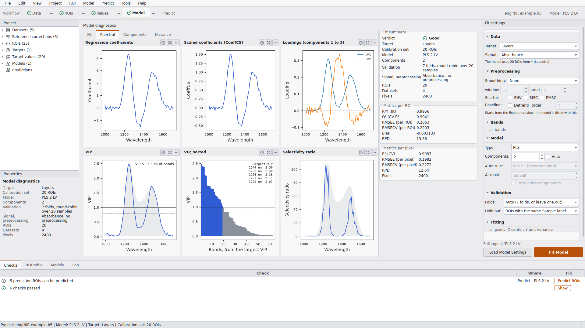
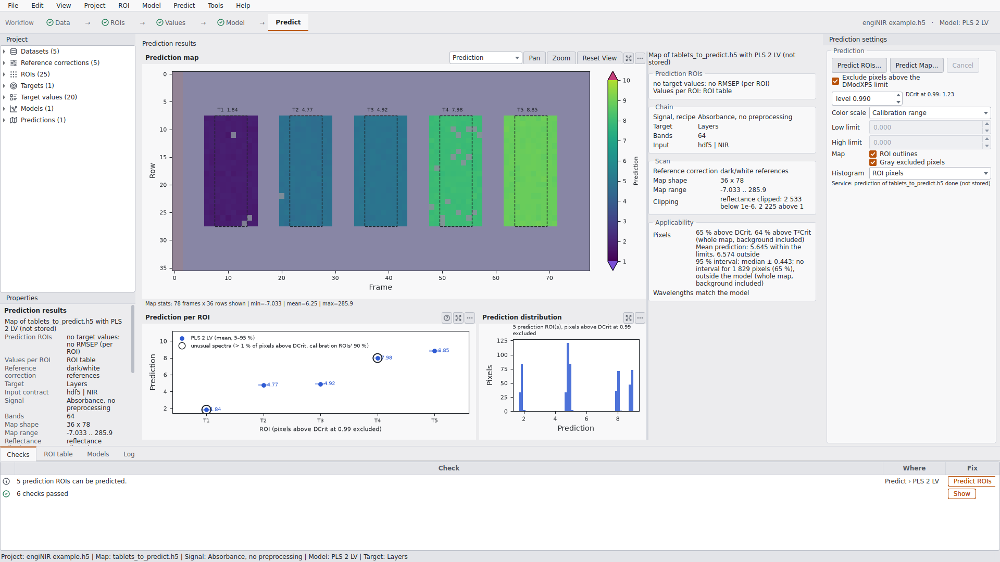

<p align="center">
  
</p>

# engiNIR

[](https://github.com/TUstudents/engiNIR/actions/workflows/ci.yml)
[](https://doi.org/10.5281/zenodo.23235907)
[](https://enginir.readthedocs.io/en/stable/)
[](https://pypi.org/project/enginir/)
[](https://pypi.org/project/enginir/)

engiNIR turns near-infrared spectra and hyperspectral images into validated
calibration models and property predictions, with every step recorded. It is
built for pharmaceutical process analytics: tablets on a tray, scanned by a
push-broom camera, measured against target values. It comes as a Python
library and as a desktop viewer that guides you through the whole workflow.

<p align="center">
  
</p>

## Try it

Install the viewer (see [Installation](#installation)), start it and choose
**Open Example Project**. The example is a synthetic tablet study: four
calibration scans with five tablets each, one scan to predict, and a fitted
PLS model, so every step of the workflow has something to show.

## Workflow

The viewer's workflow strip, **Data → ROIs → Values → Model → Predict**,
follows the steps of a calibration. A tick marks a finished step, and the
**Checks** tab says what a step still needs, with a button that fixes it.

1. **Data.** Import EVK EIFF, ENVI, HDF5, CSV/Excel, SPC, SPA and JCAMP-DX
   data. Several scans form one project. Raw counts are corrected to
   reflectance or absorbance with dark and white references (from separate
   files, frames of the same scan or another scan) or detector levels.
2. **ROIs.** Draw regions of interest on the samples, one by one or as a grid
   over a tray.
3. **Values.** Define targets with units and enter the reference value of each
   ROI.
4. **Model.** Preprocess with Savitzky-Golay smoothing and derivatives, SNV,
   MSC, EMSC, detrending, AsLS baseline correction and band selection, and fit
   PLS or PCR, cross-validated by ROI so that no sample's pixels are split
   across folds. The number of components can be chosen automatically
   (one-SE, Q² and F-test rules with a noise guard). Review the figures of
   merit, scores and loadings, VIP and selectivity ratio, Hotelling's T² and
   the distance to the model (DModX); a verdict sums up whether the model is
   fit for use.
5. **Predict.** Apply the model to new scans: a prediction map with the
   distance to the model and a 95 % prediction interval per pixel, and
   per-tablet results for marked prediction ROIs.

| Data | Model: spectral diagnostics | Predict |
|:---:|:---:|:---:|
|  |  |  |
| A scan with its ROIs, sensor frame and profiles | Coefficients, loadings, VIP, selectivity ratio | Prediction map, per-tablet results |

Every plot exports PNG, SVG and CSV.

## Guiding principles

**Sound by construction.** Calibration and prediction run through one
pipeline. Models are validated by sample, not by pixel: ROIs are the unit of
cross-validation and of every reported metric. A scan that does not match the
model is refused, and every predicted pixel states whether it lies inside the
model and how precise it is.

**Traceable for regulated work.** One project file links data, references,
ROIs, recipes and models by stable ids; stored objects are never overwritten,
and a refit is a new model. engiNIR supplies the evidence that ICH Q2(R2),
Q12 and Q14, USP <1039> and <1119> and the FDA PAT guidance ask for; see the
[regulatory context](https://enginir.readthedocs.io/en/latest/user_guide/regulatory.html)
for what it covers and what it does not.

## Installation

engiNIR needs Python 3.12 or newer.

**The viewer on Windows, without Python knowledge:** paste this line into
PowerShell, then start *engiNIR Viewer* from the Start menu (details in the
[installation guide](https://enginir.readthedocs.io/en/stable/user_guide/installation.html)):

```powershell
powershell -ExecutionPolicy ByPass -c "irm https://github.com/TUstudents/engiNIR/releases/latest/download/install-enginir-for-windows.ps1 | iex"
```

**In a Python project**, with [uv](https://docs.astral.sh/uv/) or pip:

```bash
uv add enginir
pip install enginir
```

Then start the viewer:

```bash
uv run enginir-viewer                                  # welcome screen
uv run enginir-viewer project.h5                       # open a project
uv run enginir-viewer scan.eiff --dark dark.eiff --white white.eiff
```

`enginir-viewer-console` is the same viewer with a console window, for
messages and `--help`.

## Library

The library can be used in two ways.

**Project mode** records every step in a project file, so each result is
reproducible and traceable to its data, and the file opens in the viewer.
Recommended unless you know exactly which steps you need:

```python
from enginir import PreprocessingRecipe, Project

project = Project.create("tablets.h5")
scan = project.add_dataset("scan.eiff", dark="dark.eiff", white="white.eiff")
project.add_target("API content", unit="% w/w")
scan.add_roi("tablet 1", frames=(0, 4), rows=(0, 9), values={"API content": 1.0})
# ... more ROIs, and ROIs marked job="prediction" for the tablets to predict
model = project.fit("API content", recipe=PreprocessingRecipe(snv=True),
                    n_components="auto")
model.metrics["rmsecv"]
model.verdict()                 # is the model fit for use, and why

prediction = model.predict("new_scan.eiff")
prediction.map                  # one value per pixel
prediction.dmodx_map            # distance to the model
prediction.interval_map()       # ± half-width of the 95 % prediction interval

result = model.predict_rois()   # per tablet: mean, SD, interval, RMSEP
```

**Function mode** uses the readers, preprocessing steps, models and
validation functions directly on arrays, as scikit-learn estimators:

```python
from sklearn.pipeline import make_pipeline
from enginir.io import load_spectra
from enginir.models import PLSRegression
from enginir.preprocessing import SNV
from enginir.validation import cross_validate

X = load_spectra("spectra.csv").X          # (n_samples, n_bands)
# y: reference values, samples: one label per spectrum
model = make_pipeline(SNV(), PLSRegression(n_components=4))
cv = cross_validate(model, X, y, cv="logo", groups=samples)   # cv["rmsecv"], cv["y_pred"]
```

## Documentation

The documentation is at <https://enginir.readthedocs.io>: a workflow guide,
the user guide for each step and the viewer, the API reference, and the file
formats. Changes are listed in the [changelog](CHANGELOG.md) and the
[releases](https://github.com/TUstudents/engiNIR/releases).

## Development

Clone the repository, then:

```bash
uv sync --all-extras
uv run pytest
uv run python -m sphinx -W -E -b html docs docs/_build/html
```

Questions and bug reports go to the
[issue tracker](https://github.com/TUstudents/engiNIR/issues).

## Citation

If you use engiNIR in your work, please cite:

> Johannes Poms. (2026). TUstudents/engiNIR: A universal engineering tool for
> near-infrared spectra and hyperspectral imaging. Zenodo.
> https://doi.org/10.5281/zenodo.23235907

## License

engiNIR © 2026 Johannes Poms and contributors, licensed under
[CC BY 4.0](LICENSE).
